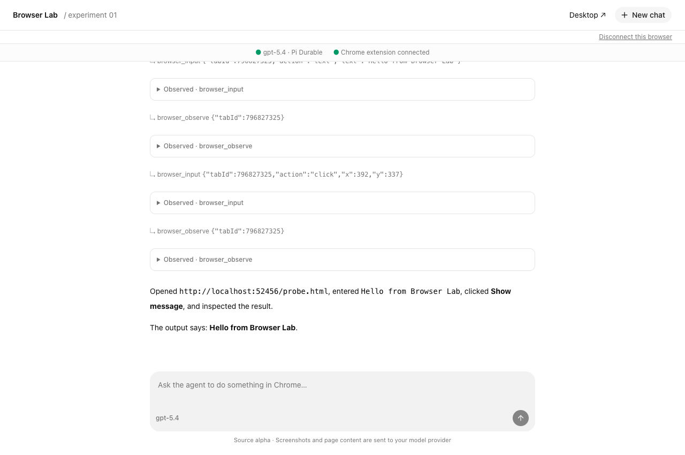

# Browser Lab

A small experiment: chat with a Pi Durable agent that controls browser tabs through a Chrome extension—and, optionally, a desktop through a background noVNC tab.

**Source alpha · MIT · macOS and Linux browser workflow · Node.js 24 or 26**

The first task is deliberately recognizable: the agent opens the included test page, types **Hello from Browser Lab**, clicks **Show message**, and checks the result. No VNC server or second computer is needed.

## Use it with your AI agent

Give this prompt to a coding agent with shell, file, Git, and network access. Supply your model credentials privately through its environment first. The live demo makes billable model requests and downloads an isolated Chromium browser; it does not use your everyday browser profile.

> Clone https://github.com/dispatchlabs-ai/browser-lab into a new directory. Read docs/quickstart.md and complete the single-machine browser demo. Use the credentials I provide through the environment; never print or commit them. Run the checks and the live demo, inspect its saved result, and report exact results and any setup still needed. Do not enable desktop access or install into my everyday browser unless I ask.

Prefer to do it yourself? Follow the [manual quickstart](docs/quickstart.md#manual-chrome-session). For a credential-free check, use the [extension smoke workflow](docs/quickstart.md#verify-without-model-credentials).

The app supplies the chat UI, durable agent backend, extension, and optional noVNC bridge. Your coding agent helps install and verify it. You supply Node.js, model access, and any desktop/VNC setup. See the [dated verification record](docs/verification.md) for what was actually tested.

## What you can try

- Inspect ordinary web tabs, navigate, click, type, press keys, and scroll.
- Resume a conversation after reloading the chat page.
- Connect your own VNC desktop, then let the agent observe and control it while the viewer tab stays in the background.
- Run the backend on another machine using your own HTTPS proxy and private network.

This is a single-owner application and a source-level experiment. It has no shell tool, general-purpose workflow scheduler, multi-user isolation, or promise of unattended reliability. Windows and Linux native-desktop control have not been qualified for this alpha.

## Authority and data

The extension uses Chrome's `debugger` and `tabs` permissions. A paired agent can inspect and act in other tabs in that profile. Use a dedicated profile with synthetic content while experimenting. Screenshots, visible page content, tab titles and URLs can reach your selected model provider. Transcripts and tool results are stored on the backend machine.

Pairing links are short-lived and single-use. Stop the current run in chat, disconnect the browser, or revoke all sessions with `npm run revoke`. Read [security and data boundaries](SECURITY.md) before connecting a real desktop or a remote backend.

## Inside the repository

| Path                                         | Owns                                               |
| -------------------------------------------- | -------------------------------------------------- |
| [packages/web](packages/web)                 | Next.js UI, Pi Durable backend, pairing, noVNC     |
| [packages/extension](packages/extension)     | Chrome debugger tools and the origin-scoped bridge |
| [docs/quickstart.md](docs/quickstart.md)     | User and agent setup, diagnosis, cleanup           |
| [docs/desktop.md](docs/desktop.md)           | Optional desktop and split-machine setup           |
| [docs/architecture.md](docs/architecture.md) | Control path, interfaces, failure behavior         |
| [CONTRIBUTING.md](CONTRIBUTING.md)           | Development and reproducible checks                |

Created by **Chris Reynolds, cofounder of Dispatch Labs AI**. Published by Dispatch Labs AI. The UI began with [shadcn-ui/chatbot-template](https://github.com/shadcn-ui/chatbot-template); its MIT attribution is preserved. See [third-party notices](THIRD_PARTY_NOTICES.md).
