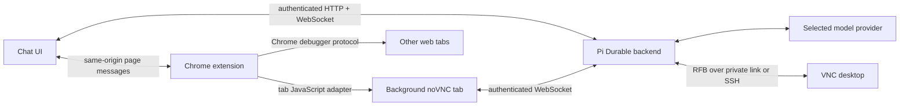

# Architecture and interfaces

Browser Lab is a runnable single-owner application, not an embeddable SDK. The UI and server belong together in `packages/web`; the independently loaded Chrome extension lives in `packages/extension`. Root scripts configure and verify the application.

The backend stores durable conversations and image tool results in SQLite. The browser page relays commands; the extension performs browser actions and returns observations. There is no model credential in the extension and no browser-debugging port exposed on the network.

## Tool contract, alpha 1

| Tool               | Inputs                                    | Observable effect/result                                                                                                  |
| ------------------ | ----------------------------------------- | ------------------------------------------------------------------------------------------------------------------------- |
| `browser_tabs`     | none                                      | Tab IDs, titles, URLs, active state, controlling-chat marker                                                              |
| `browser_navigate` | absolute HTTP(S) `url`, optional `tabId`  | Opens a tab or navigates one; returns tab ID and URL                                                                      |
| `browser_observe`  | `tabId`                                   | Web: screenshot, visible text, viewport, element bounds. Desktop: live RFB image, dimensions, connection/visibility state |
| `browser_input`    | `tabId`, `action`; action-specific fields | `click`: `x,y`; `text`: `text`; `key`: `key`; `scroll`: `deltaY` and optional `x,y`                                       |

Ordinary tab coordinates are CSS viewport pixels. Desktop coordinates are remote image pixels. Never reuse coordinates from a stale observation. Ordinary input activates the target tab; desktop input keeps the noVNC tab in the background. Navigation and input into the controlling chat tab are rejected. Browser-internal pages and non-HTTP(S) targets are unsupported.

Text observation is limited to 20,000 characters and 120 visible element records. Screenshots are JPEG. Commands have a 45-second reply deadline. WebSocket payloads are capped at 16 MiB and HTTP JSON bodies at 64 KiB. These are message/resource bounds, not guarantees that very large desktop frames will fit.

Key strings use modifiers such as `Control+a`, `Meta+space`, `Shift+Tab`, and named keys such as `Enter` or `Escape`. The desktop adapter maps modifiers for the configured remote platform, independent of the browser host's OS. Pasteboards, file transfer, right-click, drag, and a comprehensive keyboard layout API are outside this alpha's contract.

## Bridge messages

The backend sends `{type:"command", id, command:{name,...arguments}}` over `/bridge?conversation=<id>`. The page forwards `{source:"browser-lab-page", id, command}` using `window.postMessage` to the configured origin. The content script forwards to its service worker. The reply is `{source:"browser-lab-extension", id, result}` or the same envelope with `error`. The page sends `{type:"result", id, result, error}` back to the backend.

The backend correlates each result with both request ID and issuing socket. A result from another conversation's socket cannot satisfy it. The extension validates the sender's origin as well as the content script's origin/source checks. The bridge is a trusted application interface, not a public extension API or arbitrary-code execution tool.

Only one browser bridge owns a conversation at a time. Disconnect, cancellation, and timeout reject pending work. An input may have executed before its result was lost; the runtime marks input/navigation as unsafe to replay automatically and the instructions require a fresh observation before repeating. Cancellation stops future orchestration, not previously delivered input.

## Background desktop behavior

Capturing a desktop while its viewer is foreground creates a recursive mirror. The extension selects the chat tab if necessary, then reads the noVNC RFB backbuffer using `toDataURL`. It sends text and keys through `RFB.sendKey`, and pointer/wheel events through the viewer's existing canvas. All input still traverses the same tab's VNC connection. This avoids depending on Chrome keyboard focus after a native application becomes active.

The viewer may report a hidden tab while its framebuffer continues to receive updates. Results include `tabActive` and the document visibility. If the VNC connection is gone, observation reports disconnection and input fails. Opening the viewer manually on the same captured display can still show a recursive mirror.

## HTTP and local administration

The [OpenAPI document](openapi.json) describes the alpha HTTP interface. These endpoints serve the shipped UI; external clients must supply the same cookie, Host, Origin, validation and retry semantics. WebSocket frames are described above. Neither is a stable cross-version SDK.

| Operation                 | Browser/HTTP            | Local CLI                           | Authority                                                           |
| ------------------------- | ----------------------- | ----------------------------------- | ------------------------------------------------------------------- |
| Inspect liveness          | `GET /healthz`          | `doctor --live`                     | Public minimal metadata                                             |
| Inspect pairing/config    | `GET /api/status`       | `doctor` checks local configuration | Browser settings require session; local doctor sees operator config |
| Issue pairing link        | none                    | `pair` / `pair --json`              | Local filesystem administrator                                      |
| Redeem link               | `POST /api/auth/pair`   | none                                | Exact origin + valid one-use token                                  |
| Open/reload conversation  | `POST /api/lab/session` | none                                | Paired owner                                                        |
| Submit message            | `POST /api/lab/input`   | live demo uses UI                   | Paired owner; stable `requestId` for uncertain submission retries   |
| Cancel run                | `POST /api/lab/stop`    | none                                | Paired owner                                                        |
| Revoke current browser    | `POST /api/auth/logout` | none                                | Paired owner                                                        |
| Revoke all sessions/links | none                    | `revoke`                            | Local filesystem administrator                                      |

Local administration deliberately accesses the authorization store directly; it does not impersonate a remote API client. Paired browsers share one owner and all conversations. HTTP auth-denial, one-use token, origin rejection, bridge binding, cancellation/disconnect, and live revocation are exercised by the checks. Synthetic VNC transport tests do not qualify real desktop behavior.
