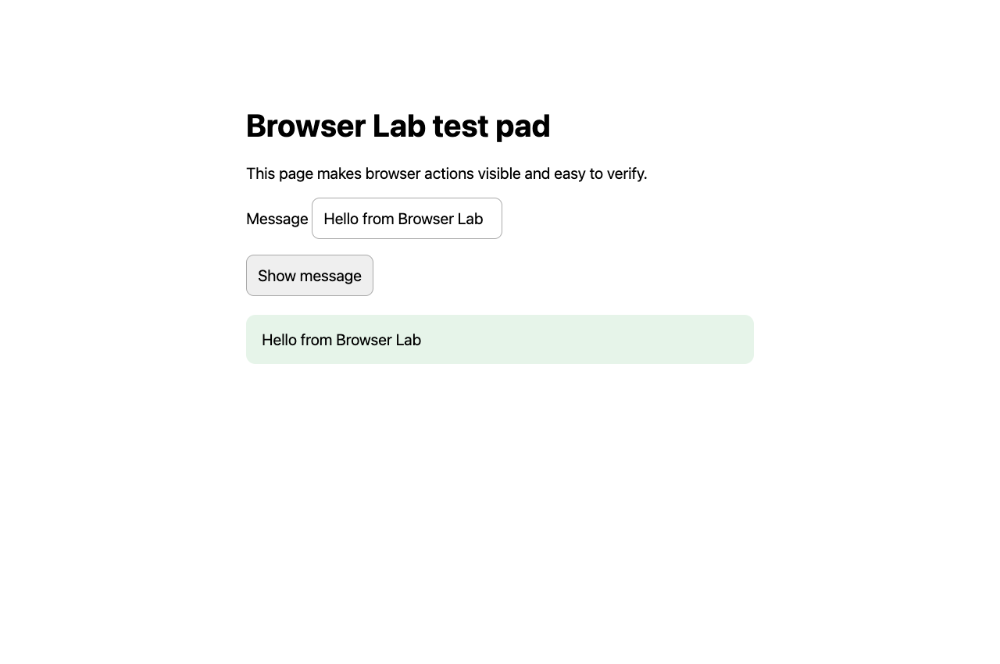

# A chatbot, a Chrome extension, and a desktop hiding in a tab

I wanted to try a small idea: could a chatbot control another browser tab, then use that same connection to operate a native desktop?

The result is [Browser Lab](https://github.com/dispatchlabs-ai/browser-lab), an MIT source alpha built around Pi Durable, a Chrome extension, and noVNC. The first public demo is simple enough to inspect: the agent opens a test page, types **Hello from Browser Lab**, clicks a button, and verifies the output.

That small task is also the starting point for anyone who wants to reproduce the experiment. You do not need a VNC server, a second computer, or access to a particular private model.

## The browser is the connection

The application began with the [shadcn chatbot template](https://github.com/shadcn-ui/chatbot-template). I kept the chat interface and connected it to a Pi Durable backend. The model has four tools: list tabs, navigate, observe, and send input.

The backend does not open a browser-debugging port on the network. It sends a tool command to the paired chat page over a WebSocket. The page relays it to a Chrome extension, which uses Chrome's debugger API to act in another tab. Observations travel back along the same path.

An observation contains a screenshot, visible text, and the bounds of useful elements. The agent can click, type, press keys, and scroll. It inspects the page again after meaningful actions, so a successful tool call is not the only evidence that the intended result happened.

Pi Durable keeps the conversation and tool results on the backend. Reloading the chat reconnects to that conversation. It does not make a browser action reversible: if a click executes and the connection disappears before its result returns, the application reports an uncertain outcome. It should inspect the page before repeating the action.

The original experiment put the backend on Linux and the browser on a Mac. The public quickstart starts on one machine because that is enough to understand the control path.

## A desktop is another tab—with a catch

The next step was to open a noVNC viewer in the same browser. noVNC speaks RFB to a VNC server and renders the desktop in a canvas. The extension can reach that tab just as it reaches the test page.

Two problems made this more interesting than simply clicking the canvas.

First, keyboard focus moved. Once a native application became active on the Mac, simulated browser keystrokes did not reliably reach the desktop session. The fix was to send text and key chords through the tab's existing noVNC connection using `RFB.sendKey`. Mouse and wheel input still pass through the viewer's canvas. There is no additional native control agent.

Second, the desktop could see its own viewer. Putting a live image of a screen on that same screen produces the familiar hall of mirrors. The agent was spending attention on a feedback loop.

The useful arrangement was to leave the viewer tab in the background and read the live RFB framebuffer directly. The extension can observe that image and send input without bringing the viewer forward. Desktop coordinates refer to pixels in the remote image, while ordinary browser tools use CSS viewport pixels.

The private prototype verified `58 × 17 = 986` in native Calculator with the viewer hidden. The portable public code was checked again with `61 × 13 = 793`, using the real macOS Screen Sharing service and an isolated Chromium profile. A fresh desktop observation showed the expression and result; I checked Calculator independently too. This verifies one narrow desktop task; other workflows need their own checks.

## Making the experiment reproducible

The first working version assumed my domain, machines, credentials, and deployment setup. That was enough to prove the idea, but too much to ask of a reader.

The source alpha has two npm workspace packages: the web application and the extension. One configuration controls the app origin, model/provider, private state directory, and optional VNC endpoint. A root command generates the extension for that origin. Machine inventory stays outside the public repository.

The default live demo uses OpenAI's API with GPT-5.4. Other Pi models and providers can be configured, but the verification record names only combinations actually tested. The application does not supply credentials, subscription access, or a VNC server.

The README includes a short prompt for a coding agent and a separate operational guide. The agent can clone the repository, install dependencies, run the checks, run the real model demo, and inspect the saved output. There is also a manual Chrome path.

Testing that prompt was useful in its own right. A fresh Claude session completed the task and found a diagnostic that incorrectly reported a working key as missing. It also noticed that the supposedly isolated demo touched the normal provider-state path. Both were corrected. The [dated verification record](https://github.com/dispatchlabs-ai/browser-lab/blob/main/docs/verification.md) records the fresh-agent runs, operating systems, models, review scope, and limitations.

## Authority is part of the interface

A debugger extension is powerful. A paired agent can inspect and act in other tabs in its profile. With VNC connected, it can operate the configured desktop. Calling this an experiment does not make those actions pretend.

Browser Lab defaults to loopback, generates the extension for one origin, and requires a short-lived, single-use pairing link. Browser sessions can be revoked, including their active control connections. Remote origins require HTTPS; the alpha is intended for a private network and one owner, with no multi-user isolation.

Screenshots, visible page content, and tab metadata can reach the selected model provider. Durable conversation data stays on the backend until the owner removes it. The quickstart explains those boundaries, stopping control, and cleanup. The synthetic demo uses a disposable browser profile so someone can try the mechanism before granting access to everyday tabs or a real desktop.

## Try the small task first

Browser Lab is source-only software: no installer, browser-store release, or promise of unattended reliability. Browser workflows are checked on macOS and Linux; the native desktop demonstration is macOS. Linux desktop control and Windows remain unqualified.

If the idea interests you, start with the test page. Watch the agent open it, type the message, click the button, and check the result. Then read the short control path and decide whether the optional desktop connection is useful for your own experiment.

[Source, quickstart, and releases](https://github.com/dispatchlabs-ai/browser-lab)

---

Draft for an X article. Review links and the final release tag before posting. The included image is synthetic browser content; private desktop captures are intentionally excluded.
